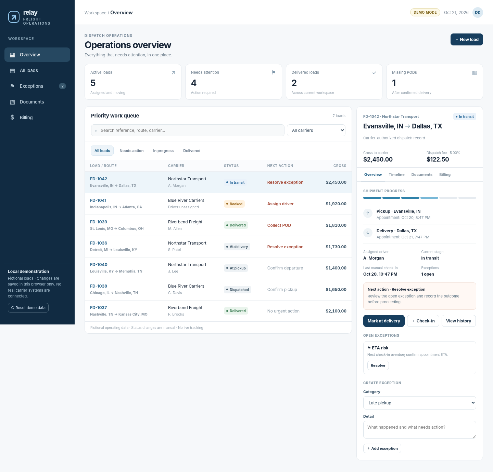

# Relay — Freight Dispatch TMS

A **non-asset-based freight dispatch operations** prototype for dispatch teams working on behalf of contracted motor carriers.

> **Status:** Interactive, browser-only proof of concept. Fictional sample data. **Not** a production multi-tenant TMS, connected load board, broker, ELD, communications, or payment system.



## Run locally

Requires Node.js 22 or newer.

```bash
npm install
npm run dev
```

Open `http://localhost:4173`. Alternatively, open `index.html` directly.

## Quality checks

```bash
npm run lint
npm run check
npm test
npm run build
```

The build creates a static `dist/` folder, without connecting to third-party services. There are no runtime npm dependencies. The static checks are **not** a substitute for browser E2E tests or production security review.

## Current prototype features

- Prioritized work queue, load list, filtering, and responsive mobile cards
- Carrier-specific load creation and driver assignment
- Shipment milestone advancement and manual check-ins
- Load details, internal notes, activity timeline, and exception resolution
- Document **receipt flags** for rate confirmation/BOL/POD; **no actual files are uploaded**
- Separate tracking for carrier billing packet and dispatch service fee invoice
- Local browser storage with demo data reset

## Production implementation

See [full-stack build plan](docs/build-plan.md), [Codex implementation brief](docs/codex-tasks.md), [product requirements](docs/product-requirements.md), and [engineering decisions](docs/decisions/0001-modular-monolith.md).

**Boundary:** Relay acts for specifically authorized carriers; it must not act as an unlicensed broker. Booked loads must be tied to one pre-authorized carrier. Carrier funds and dispatch-service invoices are separate financial workflows. Legal review is required before live operation.

## Codex instructions

`AGENTS.md` describes the architecture guardrails, contribution workflow and acceptance criteria. Start with the first task in `docs/codex-tasks.md`. Complete changes through UX → API → authorization → data → events → tests → deployment, with atomic commits.

## Repository policy

Keep this repository private until authentication, authorization, privacy and security controls have been implemented and independently reviewed. Do not commit real carrier data, load paperwork, API keys or employee/driver PII.

### Demo limitations

- No persistent backend, shared tenancy, authentication, user management, document storage, GPS, messaging, accounting integration, real payments, or external requests.
- Client-side mock authorization is **not** production access control.
- Browser local storage is for fictional sample data only. Use Reset demo to clear saved demo edits.

## License

No license granted yet. Add an explicit license if and when you decide to publish or distribute this project.
