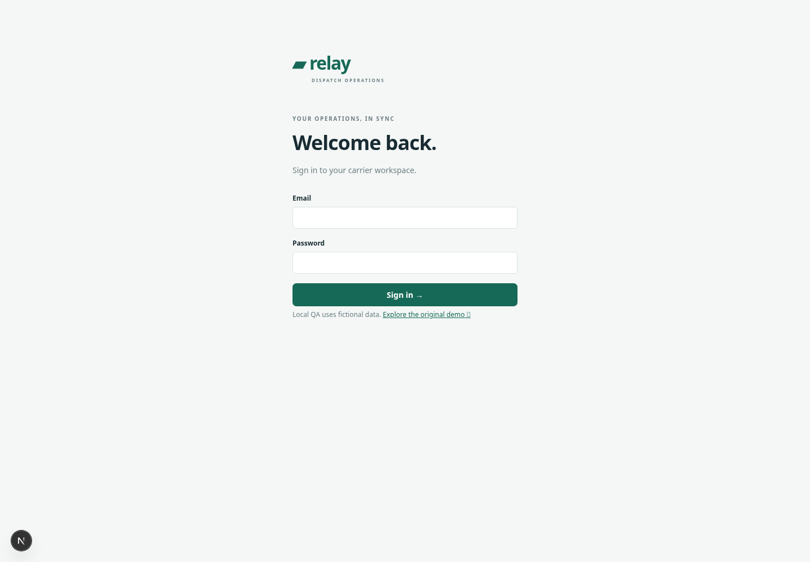
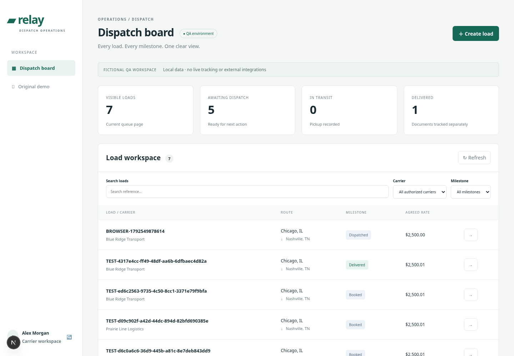
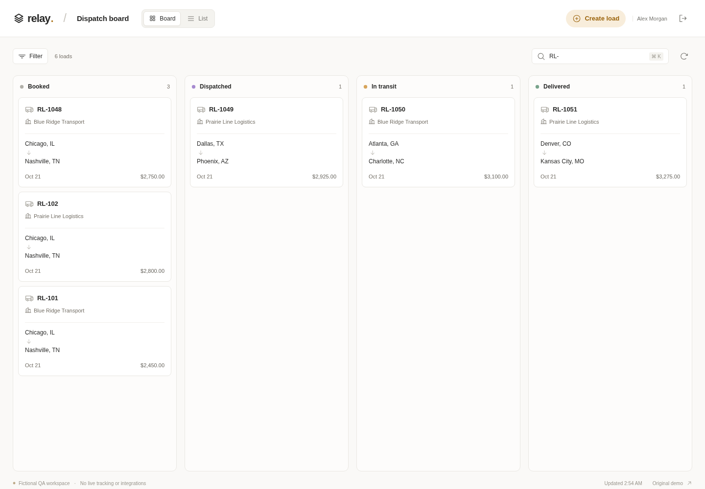
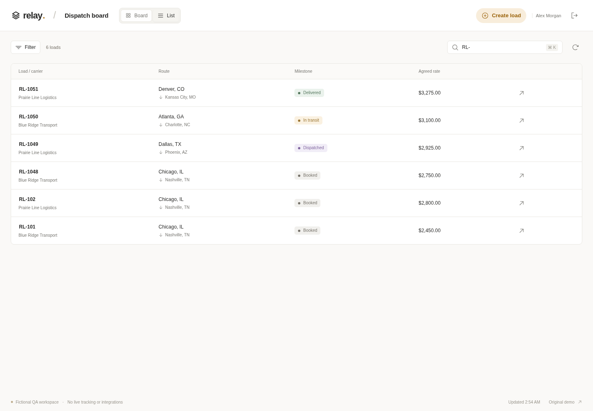
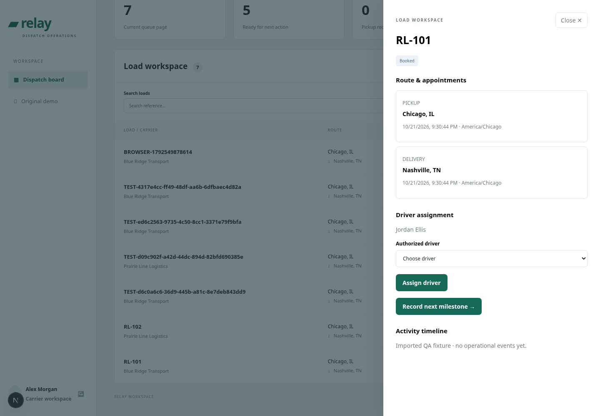
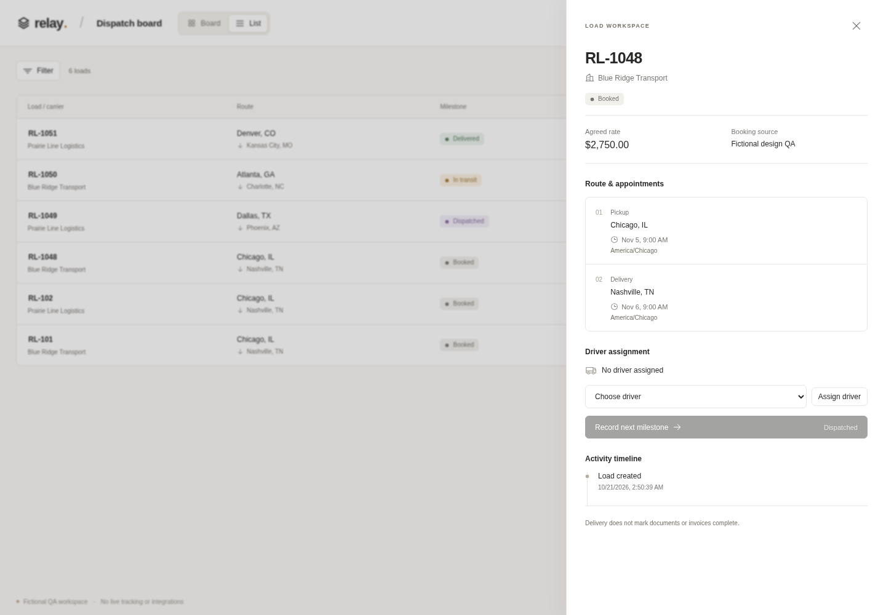
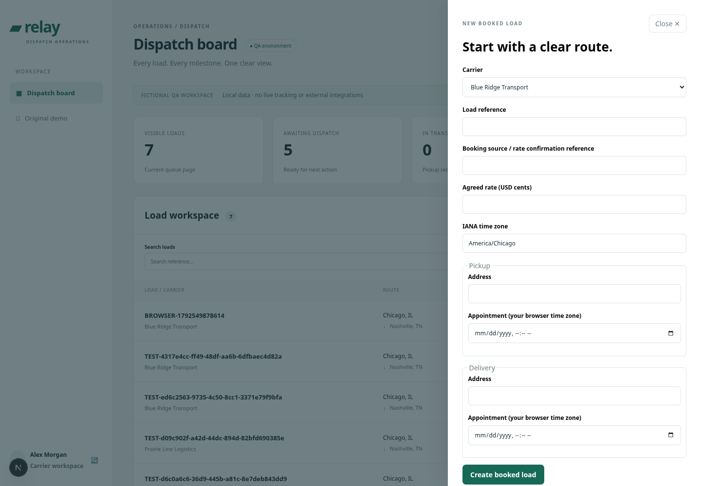
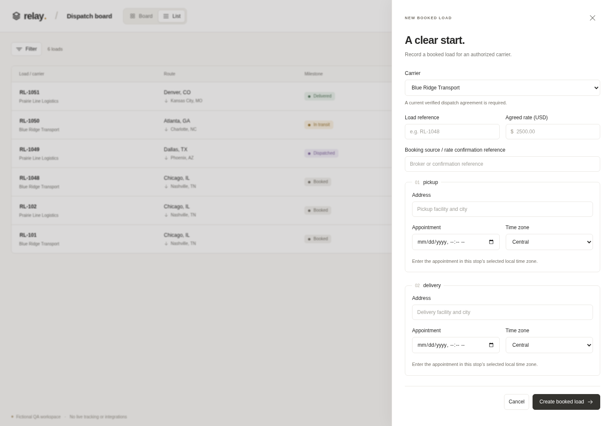
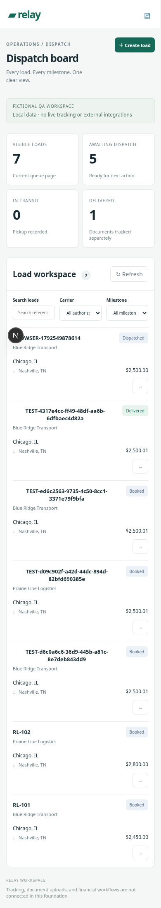
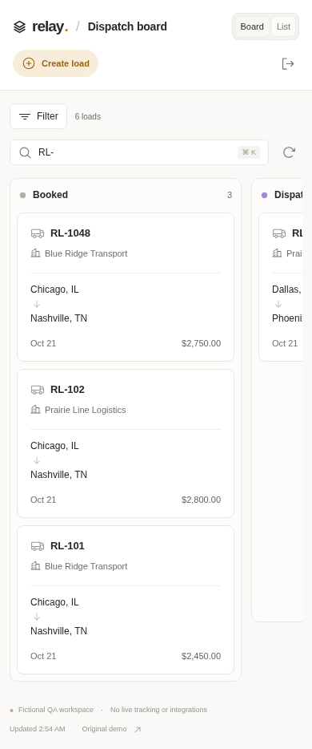

# Relay application audit and improvement pass

Reviewed baseline: `88e134f`. This is a direct source, database and browser review of the QA application, followed by fixes. It is **not a completed managed Codex Security scan or a production certification**. The installed scan skill's required supporting references and host tools were unavailable. No live carrier data, external side effects or production endpoints were tested.

## Findings and disposition

| Priority | Finding and evidence | Change / verification |
| --- | --- | --- |
| P1, operations | An expired dispatch agreement did not prevent driver assignment. `mutate` checked membership and driver ownership, but only create checked an effective agreement. A regression test initially failed because assignment succeeded after expiry. | Assignment now rechecks a verified, effective agreement in its transaction. Regression passes and rejected assignment leaves the version unchanged. Existing create retries remain reads of prior records. |
| P2, availability | Detail selected a load `FOR UPDATE` before carrier authorization. An authenticated foreign-carrier request waited on another carrier's row lock. The regression initially exceeded its one-second deadline. | Membership and assigned-driver scope are part of the SELECT; only authorized writes acquire a row lock. Foreign detail is rejected while the other carrier holds the row lock. |
| P1, authentication hardening | Login attempt counters lived in an in-memory Map: each new instance or restart provided a fresh allowance. Synchronous password derivation also blocked the event loop. | Migration 002 adds an atomic PostgreSQL counter for normalized, hashed identities. Concurrent attempts share an eight-attempt/minute allowance; password verification is asynchronous. Edge/IP limiting remains required for public rollout. |
| P2, queue correctness | Offset pagination could repeat the last item on the next page if a new load arrived between requests. | Opaque keyset cursor over creation time and ID. Test inserts a new load after reading 25 records and confirms the second page has no duplicates. Every page reapplies carrier scope. |
| P2, appointment entry | The form offered an IANA zone but interpreted datetime input in the browser's zone. The separate concepts were easy to confuse (before-create screenshot). | Each stop owns a local appointment and selected zone. Temporal converts to an instant and rejects nonexistent/ambiguous DST times. Browser test verifies 09:00 Central → 15:00 UTC and 09:00 Eastern → 14:00 UTC. |
| P2, money entry | Users had to enter cents, creating an avoidable factor-of-100 entry risk (before-create screenshot). | USD dollar entry converts through integer/BigInt arithmetic; excess precision and exponent notation are rejected. Exact cents are verified through the browser and database. |
| P2, recovery | The browser generated a new create idempotency key on every submission. If the server saved a load but its response was lost, retrying could return a duplicate-reference conflict rather than confirm success. The database's unique reference prevented duplicates. | Unchanged entries reuse the same key until successful completion or dismissal. Browser test drops the first successful response, retries, and verifies one load and matching keys. |
| P2, session UX | Expired sessions remained in the workspace with an error, and prior queue/filter state was retained across sign-outs. | Expiry or logout clears records, selected load, creation form and carrier filters. Browser test verifies return to sign-in and removal of the old queue. |
| P2, density/mobile | Large summary tiles and copy pushed the actual queue below the fold; mobile filter values were truncated (before-workspace and before-mobile). | Compact toolbar, Board/List views, expandable filters, contained horizontal board scrolling, and full-screen mobile inspector. Screenshot and browser checks confirm persistent controls remain inside the page viewport. |
| P2, fixture correctness | Original QA seed generated overlapping pickup/delivery windows despite the API invariant. | New seed creates a one-hour window for pickup on day one and delivery on day two. Fresh-database validation confirms zero overlapping routes. Existing retained QA fixtures are not silently rewritten. |

Additional hardening: explicit private/no-store API responses, JSON body limit of 64 KiB, exact login/logout/me routes, bounded database connection/statement timeouts, idle connection error handling, frame denial and MIME-sniffing protection. Denied-object responses remain denied even if audit storage is unavailable; that audit failure is logged explicitly.

## Browser audit: numbered flow

Screenshots below were captured in this review, inspected, and retained as evidence. Before captures use a local development server; its developer badge is browser tooling, excluded from product findings. After evidence uses the production server.

1. **Sign-in — functional, clearer after revision.** Labels and password autocomplete are present. The new screen reduces decorative copy. Invitations, password reset and MFA are still absent.

   

2. **Queue — improved.** Original queue is functional but large tiles dominate the viewport. The new Board and List use one API and show the current loaded record counts. Search, filters, refresh and keyboard focus are tested. The screenshot reference was supplied by the user; the live macro.com site was blocked by network policy.

   
   
   

3. **Load inspector — functional, more recoverable.** Rate, source, stops, local time zones, authorized driver and event timeline are visible. Native dialog traps focus; Escape and close restore the queue. Assignment and milestones still pass through the transactional API. A conflict offers a refresh action.

   
   

4. **Create load — corrected.** Dollars, a zone per stop and local appointments replace cents and competing time-zone concepts. Submission has a saving state, contextual errors and a stable retry key. Keyboard form entry and successful creation/assignment are exercised.

   
   

5. **Mobile workspace — improved, further device testing needed.** The queue begins immediately below controls; columns scroll within the board. No document-wide horizontal overflow at 390 × 844. Persistent actions and the inspector remain accessible. Manual screen-reader and touch-device testing remain open.

   
   

## Validation

- Node 22: lint, TypeScript, production build.
- 3 existing prototype tests, 12 entry/database tests and 6 browser tests (21 total).
- Regression tests were observed failing for expired-authority assignment and foreign-row locking before applying their fixes.
- Empty PostgreSQL database: migrations 001 and 002 applied, migration repeated, seed repeated; two migrations, two seed loads and zero overlapping routes.
- Browser tests: queue/detail/mobile, create/assign/dispatch/logout, Board/List and filters, keyboard search, expired-session recovery, dropped-response retry, exact money/time zones, input limit and response headers.
- Production browser capture checks JavaScript page errors and page overflow. See `design-qa.md` for visual comparison boundaries.
- `npm audit --omit=dev`: zero reported runtime dependency advisories at this check. This is not evidence that the application is free of security defects.

## Remaining risks and next work

1. Full dependency audit reports **five high development-tool advisories from one root**: `braces` through `micromatch` / `fast-glob` / Next's ESLint tooling (GHSA-vfj7-8cjw-p6xm). Latest registry `braces` was 3.0.3, within the affected range; no compatible patched release was available. The affected tool evaluates local glob patterns during linting, not the deployed request path. Do not downgrade the application framework merely to suppress the report; track an upstream patch and recheck.
2. Authentication is still local username/password QA infrastructure. Add invitation/recovery workflows, MFA or a trusted identity provider, edge/IP abuse controls, a session retention job, and deployment secret/role management. Per-email rate limiting can still be abused for temporary account lockout and does not bound attempts across arbitrary identities.
3. Database access uses application scoping plus relational constraints. Production needs a restricted runtime DB role, migration-owner separation, independent review and consideration of row-level security. Database owners can bypass append-only triggers.
4. No real document uploads, exceptions/check-in workflow, financial ledger, outbox consumer, tracking or third-party service is implemented. No status or claim in the UI implies those capabilities.
5. Browser coverage is Chromium desktop/mobile emulation. No WCAG certification, manual screen-reader audit, Safari/Firefox coverage, penetration test or load test was performed. Secondary labels are small; validate contrast/readability on actual dispatcher devices. Further split the workspace component as features grow.
6. Production `APP_ORIGIN`, secure cookies, managed PostgreSQL, migration rollout and operating procedures still need review. This pass does not deploy the app or make it production-ready.
