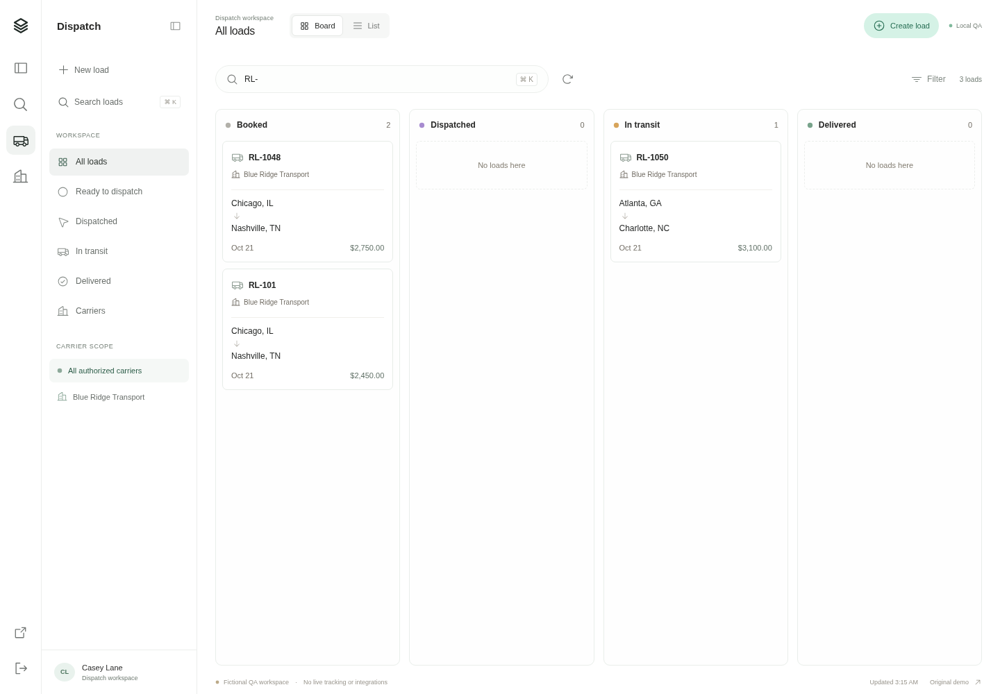
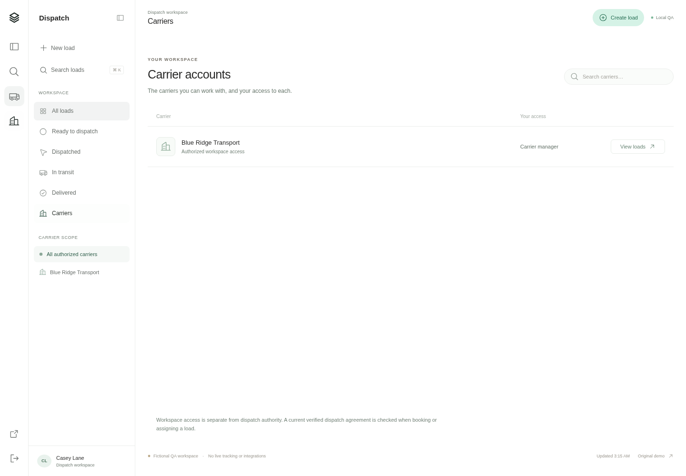
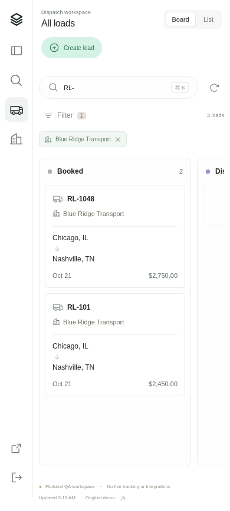
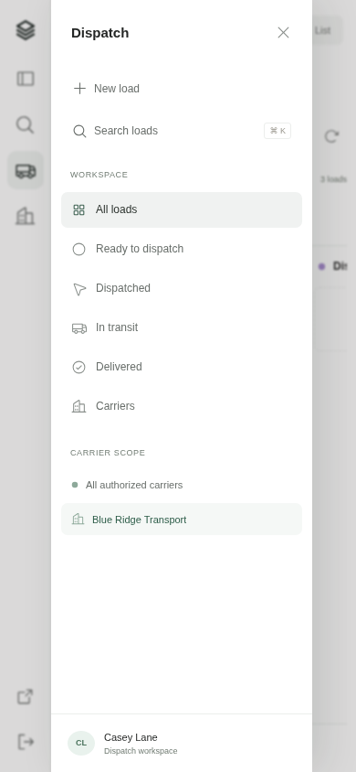

# Relay follow-up audit and navigation update

Baseline: `6f29454`, including the two previously unpushed commits. This pass combines independent backend and frontend reviews, reproduced browser failures, regression fixes, and the second user-supplied Macro reference. It is a direct application review, not a managed security scan or a production certification.

## Confirmed findings

| Priority          | Before                                                                                                                                | Fix and evidence                                                                                                                                                                             |
| ----------------- | ------------------------------------------------------------------------------------------------------------------------------------- | -------------------------------------------------------------------------------------------------------------------------------------------------------------------------------------------- |
| P2                | Clear filters set loading even when no filter changed; no new request was triggered, leaving cards and Refresh disabled indefinitely. | Filter changes compare actual next values before changing request/loading state. Repeated Clear filters and All loads selections preserve readiness.                                         |
| P2                | An older initial queue response could replace a newer post-create result, hiding the created card while still displaying success.     | Every queue request has a monotonically increasing generation; older data, errors and loading completion are discarded. A held-response browser regression verifies the new card remains.    |
| P2                | Create remained enabled during a pending detail request, allowing two modal dialogs to open together.                                 | Shared busy guards disable both create entry points. A delayed-detail regression verifies one dialog opens.                                                                                  |
| P2                | A late Load more failure could overwrite a newer filtered queue's error state; a stale 401 could clear the session.                   | Pagination's failure path now uses the same generation, filter revision and session guards as its success path. Regressions cover stale 503 and 401 responses.                               |
| P2                | HTML/empty gateway responses exposed JSON parser errors.                                                                              | API handling normalizes network and malformed gateway responses into an actionable service-unavailable message while preserving session-expiry handling. Browser HTML-503 regression passes. |
| P2                | An accepted load could lose its success acknowledgement if the following queue refresh failed.                                        | Save acknowledgement is separate from refresh success. A browser regression sees the saved notice plus refresh error, retries the queue, and verifies only one create POST occurred.         |
| P2, accessibility | Two carriers may share a load reference, but Board buttons announced only the reference.                                              | Board card accessible names include carrier names; duplicate-reference regression distinguishes both buttons.                                                                                |
| P2                | Zero/one-stop requests threw a TypeError in cross-stop refinement rather than returning a validation error.                           | Stop count is guarded before dereferencing. Regression was observed failing before the fix; malformed requests now return HTTP 400.                                                          |
| P2                | Syntactically shaped but impossible cursor dates or offsets reached PostgreSQL and returned 503.                                      | Calendar and supported offset validation happens before database casting. Authenticated route checks now return INVALID_CURSOR / HTTP 400.                                                   |
| P2                | Duplicate query fields validated the last value while the query used the first, bypassing the search-length bound.                    | Validation and SQL use the same parsed values. A repeated-field regression now returns HTTP 400 for the oversized queried value.                                                             |

The initial three frontend state bugs were reproduced in Chromium against the baseline. The three backend regressions were observed failing before source changes. Existing carrier isolation, current agreement checks, idempotency, money, time-zone and transaction tests remain in the gate. No new confirmed cross-carrier data disclosure was found; this is not evidence of complete security coverage.

## Reference-led navigation

The new reference shows a white workspace, narrow icon rail, contextual sidebar, subdued controls and a large task pane. Relay now uses that structure for its supported workflows:

1. **Load workspace — passed.** Rail and sidebar expose real queue filters; stage selection calls the existing scoped list API. Repeated selection is safe. Board and List remain two views of the same records.
2. **Carrier directory — passed.** The directory displays the current session's carrier memberships and roles. Search, empty state and View loads work; View loads applies carrier scope. Workspace membership is explicitly distinguished from written dispatch authority.
3. **Queue recovery — passed.** Older requests cannot replace current results or errors. Filter reset, delayed responses, gateway failure, lost save response and session expiry have browser regressions.
4. **Create and inspect — passed.** Both create entry points respect busy/offline state; modal overlap is blocked. Existing assignment, milestones and logout flows remain exercised.
5. **Mobile navigation — passed in Chromium emulation.** The sidebar opens in a native modal drawer, selection closes it, and page-level controls remain within a 390 × 844 viewport. Board scrolling is contained within the work surface.

Final production evidence:

The source reference is the user's conversation attachment; browser chrome and unrelated browser tabs were excluded from the product adaptation. Screenshots contain fictional QA records only. This is inspired by the reference rather than a pixel clone. Existing Board inspiration remains relevant to the load columns.

## Verification and operating notes

- Final gate: lint, typecheck, build, 18 non-browser tests and 18 Chromium browser tests (36 total), with no skipped tests.
- New navigation/recovery tests use deterministic route stubs. Existing browser workflows still use actual authenticated sessions and PostgreSQL-backed loads.
- Production screenshots are captured after data loading completes. JavaScript page errors and unexpected resource failures are checked; the initial anonymous session-check 401 is expected.
- No new database migration or dependency is introduced by this pass. The complete push also includes the earlier migration 002 for shared login controls; an existing deployment must apply migrations before starting the updated server.
- The user requires validated changes on `main`. This preference is recorded in `AGENTS.md`; remote history is preserved and no force push is used.

## Remaining limits

The production identity, edge/IP rate limiting, runtime database-role separation, retention, live documents, check-ins, exception workflow, billing and integration gaps from the prior audit remain. Previous development-tool dependency advisories are not resolved by this pass; dependencies were unchanged. Browser checks use Chromium and mobile emulation rather than physical devices or a screen-reader certification. Desktop/tablet/mobile typography and touch ergonomics need user testing. Native mobile drawer focus is tested through normal browser behavior; broader assistive-technology coverage remains open.
